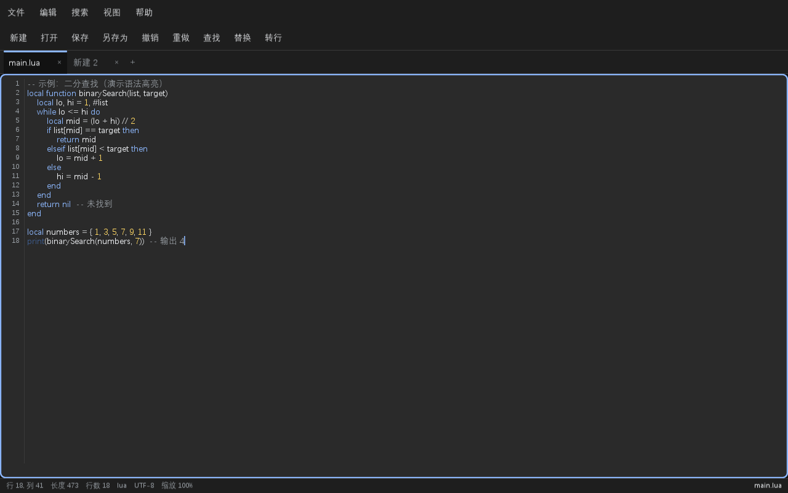

# Notepad++ 复刻版

一个基于 [LÖVE (Love2D)](https://love2d.org/) 与自研 UI 框架 **LumiUI** 实现的 **Notepad++ 风格多标签文本编辑器**。支持语法高亮、行号、多标签、查找/替换、转到行、缩放，以及中文（UTF-8）路径下的文件读写。

> 底层框架 LumiUI 的完整介绍见文末「关于 LumiUI」，框架使用文档见 [`lumi/docs/guide.md`](lumi/docs/guide.md)。

## 📸 截图



## ✨ 特性

- **多标签编辑** —— 新建 / 打开 / 关闭 / 切换，未保存 `●` 标记与关闭确认弹窗
- **语法高亮** —— Lua / JSON / XML·HTML / Python / JS / C·C++ / Markdown，按扩展名自动识别
- **完整编辑能力** —— 行号、撤销/重做、跨行选区、中文 IME 输入、横纵滚动
- **查找 / 替换 / 转到行** —— 支持查找下一个/上一个、替换、全部替换（`Ctrl+F/H/G`，`F3` 查找下一个）
- **缩放** —— `Ctrl+滚轮`、`Ctrl+` / `Ctrl-` / `Ctrl0`（60%–220%）
- **文件系统** —— 内置文件浏览器（目录导航 + 路径输入），UTF-8 BOM 处理
- **原生 Unicode 路径** —— 中文文件名 / 中文目录可正常读写（详见下文「性能与 Unicode 方案」）
- **状态栏** —— 实时显示行列、长度、行数、语言、编码、缩放

## 🚀 快速开始

需要 [LÖVE 11.x](https://love2d.org/)。Windows 下直接双击或命令行：

```bash
love .
```

也可用仓库自带的批处理（`run.bat` 使用源码构建版，`debug.bat` 使用控制台版输出错误）：

```bat
run.bat
```

## ⌨️ 快捷键

| 快捷键 | 功能 |
|---|---|
| `Ctrl+N` / `Ctrl+O` / `Ctrl+S` / `Ctrl+Shift+S` | 新建 / 打开 / 保存 / 另存为 |
| `Ctrl+W` | 关闭当前标签页 |
| `Ctrl+Tab` / `Ctrl+Shift+Tab` | 切换上一个 / 下一个标签页 |
| `Ctrl+F` / `Ctrl+H` / `Ctrl+G` | 查找 / 替换 / 转到行 |
| `F3` | 查找下一个 |
| `Ctrl+滚轮` / `Ctrl+` / `Ctrl-` / `Ctrl0` | 放大 / 缩小 / 重置缩放 |
| `Ctrl+Z` / `Ctrl+Y` / `Ctrl+A` / `Ctrl+C` / `Ctrl+X` / `Ctrl+V` | 撤销 / 重做 / 全选 / 复制 / 剪切 / 粘贴 |

## ⚡ 性能与 Unicode 方案

这是本仓库最值得参考的技术点：解决「打开文件 / 切换目录卡顿」和「中文路径保存报 `illegal byte sequence`」两个问题。

### 问题根源

| 现象 | 原因 |
|---|---|
| 点击「打开」、切换目录明显卡顿 | 文件浏览器用 `io.popen("dir ...")` 列目录，**每次都要 spawn 一个 `cmd.exe` 子进程**（几十~上百毫秒），来回切换目录时反复触发 |
| 保存 / 打开中文文件名报 `illegal byte sequence` | 文件读写用 `io.open`（**ANSI 窄字符 API**），它按系统代码页（GBK）解释路径字节，而文件浏览器产出的路径是 **UTF-8**，两者不匹配 |

### 解决方案：LuaJIT FFI 直调 Win32 **W 系列** API

不启动任何子进程、原生支持 Unicode。核心实现见 [`npp/fs.lua`](npp/fs.lua)：

- **目录列举** —— `FindFirstFileW` / `FindNextFileW` / `FindClose`，微秒级完成，并直接从 `WIN32_FIND_DATAW` 的 `dwFileAttributes` 区分目录/文件
- **文件读写** —— `CreateFileW` / `ReadFile` / `WriteFile`，路径与内容均走 Unicode
- **编码转换** —— Lua 字符串是 UTF-8，Win32 W API 用 UTF-16LE，`fs.lua` 内置了双向转换（含代理对处理）
- **回退机制** —— FFI 不可用或失败时自动回退到 `io.popen` / `io.open`

```lua
-- npp/fs.lua 对外接口
fs.listDir(dir)          -- -> dirs, files（UTF-8 文件名表，已排序）
fs.readFile(path)        -- -> data 或 nil, err
fs.writeFile(path, data) -- -> true 或 nil, err
fs.getAttributes(path)   -- -> 属性位 或 nil
fs.isDir(attrs)          -- -> boolean
```

### 实测性能

| 目录 | 耗时 |
|---|---|
| 项目目录（13 项） | ~1 ms |
| `C:\Windows\System32`（4129 项） | ~8 ms |

对比 `io.popen` 每次 spawn 子进程的几十~上百毫秒，打开与切换目录基本瞬时。

## 📁 目录结构

```
.
├── main.lua                 # 应用入口（Notepad++ 复刻版）
├── conf.lua                 # 窗口配置
├── npp/                     # 复刻版实现
│   ├── app.lua              # 多文档管理 / 文件读写 / 查找替换 / 快捷键 / 弹窗
│   ├── fs.lua               # FFI 文件系统：Unicode 目录列举 + 文件读写
│   ├── syntax.lua           # 多语言语法高亮引擎
│   ├── tabbar.lua           # 标签页条（自定义控件）
│   ├── toolbar.lua          # 紧凑工具栏（自定义控件）
│   ├── statusbar.lua        # 底部状态栏（自定义控件）
│   └── docs/screenshot.png  # 截图
├── lumi/                    # 底层 UI 框架（LumiUI）
├── demo/                    # 自定义控件示例（星级评分）
├── examples/demo.lua        # LumiUI 控件演示（原 main.lua，保留）
└── tests/                   # 无头自检测试套件
```

## 🧪 测试

无头自检覆盖框架全部能力 + 复刻版核心逻辑（构建 / 布局 / 语法高亮 / 文档操作 / 查找 / 缩放 / Unicode 路径读写 / 各弹窗）：

```bash
# 方式一：创建 verify.flag 后运行（自动退出，返回退出码）
touch verify.flag
love .          # 或控制台版 lovec .

# 方式二：设置环境变量
LUMI_VERIFY=1 love .
```

输出形如 `[TEST] 104 total, 104 passed, 0 failed`，退出码 `0` 表示全部通过。

## 关于 LumiUI

本复刻版构建于自研的 **LumiUI**（保留模式 Material Design UI 框架，声明式组件树 + Flexbox 布局，内置 20+ 控件、深/浅主题、补间动画、中文 IME 支持）。框架源码在 [`lumi/`](lumi/)，使用文档见：

- [组件 API 与案例](lumi/docs/guide.md)
- [自定义控件开发规范](lumi/docs/custom-widget.md)

> 本复刻版中的标签页条、工具栏、状态栏即为自定义控件的实战示例（`npp/tabbar.lua`、`npp/toolbar.lua`、`npp/statusbar.lua`）。
