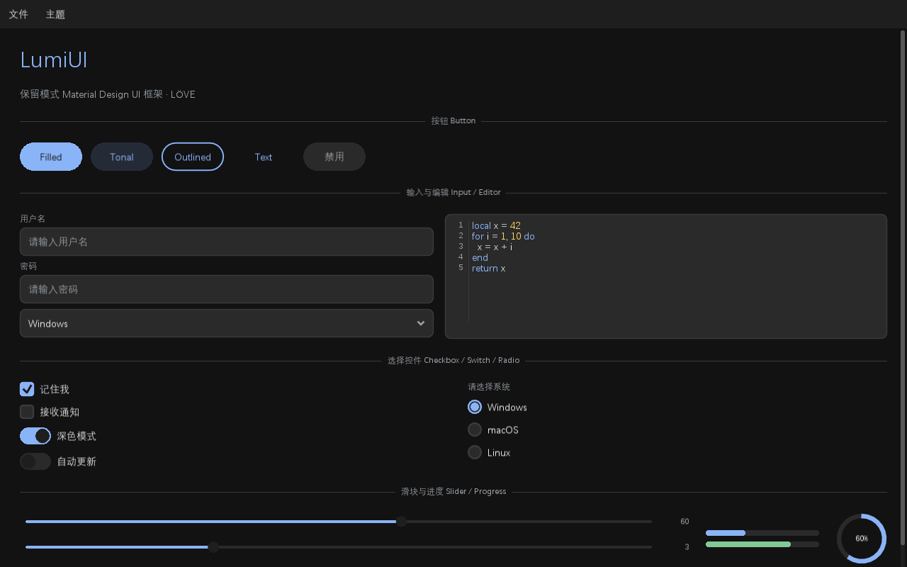

# LumiUI

一个 LÖVE（Love2D）**保留模式 Material Design UI 框架**。声明式组件树 + Flexbox 布局，内置 20+ 控件、深/浅两套主题、补间动画、中文输入法（IME）支持与调试工具。

## ✨ 特性

- **保留模式组件树** —— 声明式链式构建，布局 / 绘制 / 事件 / 焦点由框架统一管理
- **Flexbox + Grid 布局** —— `direction` / `gap` / `align` / `justify` / `grow` / `wrap` / 百分比尺寸；网格布局（`cols` / `colSpan` / `rowSpan`）、绝对定位（`position` / `anchor`）、响应式断点（`hideBelow` / `hideAbove`）
- **性能优化** —— 子树 Canvas 缓存（`cache`）、scissor 裁剪快速剔除、表格/树可视行虚拟化（2000 行如 20 行）
- **Material Design 3** —— 深 / 浅两套主题，圆角、阴影、状态过渡动画、点击波纹
- **交互与动效** —— 悬浮层统一进出场动画（缩放 + 滑入）、弹窗遮罩淡入 + 面板缩放、下拉箭头旋转补间、轮播拖拽切页（边界阻尼回弹）、滑块键盘方向键、Toast 类型图标 + 滑入滑出
- **20+ 内置控件** —— 按钮、输入框、多行编辑器、下拉、表格、树、标签页、菜单、弹窗等
- **多行编辑器** —— 行号、语法高亮、撤销/重做、查找/替换、横纵滚动
- **中文友好** —— 自动探测系统中文字体，完整支持 UTF-8 光标、选区与 IME 组合输入
- **补间动画** —— 轻量 tween 系统，支持颜色表插值与多种缓动函数
- **调试工具** —— F2 切换布局外框 / 控件树 / FPS 叠加层

## 📸 截图



## 🚀 快速开始

需要 [LÖVE](https://love2d.org/) 11.x 或 12.x（本机构建为 12.0，版本声明见 `conf.lua` 的 `t.version`）。

```bash
# 运行演示
love .
```

`main.lua` 是一个自包含的演示，覆盖全部控件，交互结果输出到控制台并以 Toast 提示。

### Windows 启动脚本

三个批处理脚本默认使用 `C:\workspace\love2dsrc\build` 中的 LÖVE 可执行文件：

- `run.bat` —— 用 `love.exe` 正常启动演示
- `debug.bat` —— 用 `lovec.exe` 启动，可在控制台看到 `print` 输出
- `test.bat` —— 自动创建 `verify.flag` 运行自检，输出 `[PASS]` / `[FAIL]` 后暂停

如果 LÖVE 构建目录不同，修改脚本开头的 `LOVE_DIR`，或用同名环境变量覆盖，例如 `set LOVE_DIR=D:\love2d\build`。脚本会自动切换到自身所在目录，从任意位置调用都能正确加载项目。

### 最小示例

```lua
local lumi = require("lumi")

local ui

function love.load()
    ui = lumi.new()
    ui:root({ direction = "column", padding = 20, gap = 12 })
      :label("你好，LumiUI", { variant = "title" })
      :button("点击我", { variant = "filled", onClick = function() print("clicked") end })
      :input({ placeholder = "输入点什么…" })
end

function love.update(dt) ui:update(dt) end
function love.draw() ui:draw() end

function love.mousepressed(x, y, b) ui:mousepressed(x, y, b) end
function love.mousereleased(x, y, b) ui:mousereleased(x, y, b) end
function love.mousemoved(x, y) ui:mousemoved(x, y) end
function love.wheelmoved(x, y) ui:wheelmoved(x, y) end
function love.keypressed(k) ui:keypressed(k) end
function love.textinput(t) ui:textinput(t) end
function love.textedited(t, s, l) ui:textedited(t, s, l) end
function love.resize(w, h) ui:resize(w, h) end
```

## 🧩 内置控件

| 控件 | 方法 | 说明 |
|---|---|---|
| box / panel | `ui:box({...}, fn)` | 通用容器 / 卡片 |
| scroll | `ui:scroll({...}, fn)` | 滚动区 |
| tabs | `ui:tabs({...}, fn)` | 标签页 |
| label | `ui:label("文本", {...})` | 文本标签 |
| button | `ui:button("文本", {...})` | 按钮（4 种变体） |
| input | `ui:input({...})` | 单行输入框 |
| editor | `ui:editor({...})` | 多行文本编辑器 |
| checkbox | `ui:checkbox({...})` | 复选框 |
| switch | `ui:switch({...})` | 开关 |
| radio | `ui:radio({...})` | 单选按钮 |
| slider | `ui:slider({...})` | 滑块（拖拽 / 键盘方向键 / 焦点环） |
| progress | `ui:progress({...})` | 进度条 |
| dropdown | `ui:dropdown({...})` | 下拉选择（列表滑入动画 + 箭头旋转） |
| table | `ui:table({...})` | 表格 |
| tree | `ui:tree({...})` | 树 |
| menu | `ui:menu({...})` | 菜单栏 |
| divider | `ui:divider({...})` | 分隔线 |
| image | `ui:image({...})` | 图片显示（fit 模式 / 圆角裁剪 / 染色 / 点击） |
| avatar | `ui:avatar({...})` | 头像（圆形裁剪 / 文字回退 / 角标） |
| icon | `ui:icon("home", {...})` | 矢量图标（30+ 内置，无需图片资源） |
| carousel | `ui:carousel({...})` | 图片轮播（箭头 / 指示点 / 自动播放 / 拖拽切页） |
| dialog | `ui:dialog({...}, fn)` | 模态弹窗（进出场动画 / closable 关闭按钮） |
| toast | `ui:toast("消息", "type")` | 轻提示（info / success / error 类型样式） |
| tooltip | `props.tooltip = "…"` | 悬停提示 |

## 📚 文档

- [使用文档（组件 API 与案例）](lumi/docs/guide.md)
- [自定义控件开发规范](lumi/docs/custom-widget.md)

## 📁 目录结构

```
.
├── main.lua                 # 演示入口（覆盖全部控件）
├── conf.lua                 # 窗口配置
├── lumi/                    # 框架源码
│   ├── init.lua             # 入口：lumi.new() / lumi.register()
│   ├── context.lua          # 场景调度器（事件路由 / 悬浮层 / 焦点）
│   ├── node.lua             # 节点基类（树 / 布局 / 绘制 / 命中测试）
│   ├── widget.lua           # Widget 基类（回调触发）
│   ├── layout.lua           # Flexbox 布局引擎
│   ├── theme.lua            # 主题（配色 / 圆角 / 字号 / 动画时长）
│   ├── animate.lua          # 补间动画
│   ├── font.lua             # 字体管理（CJK 探测）
│   ├── draw.lua             # 底层绘制工具（圆角 / 阴影 / UTF-8）
│   ├── event.lua            # 事件树遍历工具
│   ├── debug.lua            # 调试叠加层
│   ├── widgets/             # 全部内置控件
│   └── docs/                # 文档与截图
├── demo/                    # 自定义控件示例（星级评分）
└── tests/                   # 无头自检测试套件
```

## 🧪 测试

无头自检覆盖全部控件与核心能力（布局 / 主题 / 事件 / 中文输入 / 交互与动画）：

```bash
# 方式一：创建 verify.flag 后运行（自动退出，返回退出码）
touch verify.flag
love .          # 或控制台版 lovec .

# 方式二：设置环境变量
LUMI_VERIFY=1 love .
```

输出形如 `[TEST] 227 total, 227 passed, 0 failed`，退出码 `0` 表示全部通过。测试按控件分组隔离执行，某组抛异常只记一条失败，不会中断其余用例。

## 🎨 主题与动画

```lua
ui:setTheme("dark")   -- 或 "light"

-- 自定义主题
lumi.theme.custom("dark", { colors = { primary = "#FF7A45" }, shape = { medium = 12 } })

-- 补间动画（数值 / 颜色表插值）
lumi.animate.to(node, { x = 300 }, { duration = 0.3, easing = "cubic" })
```
