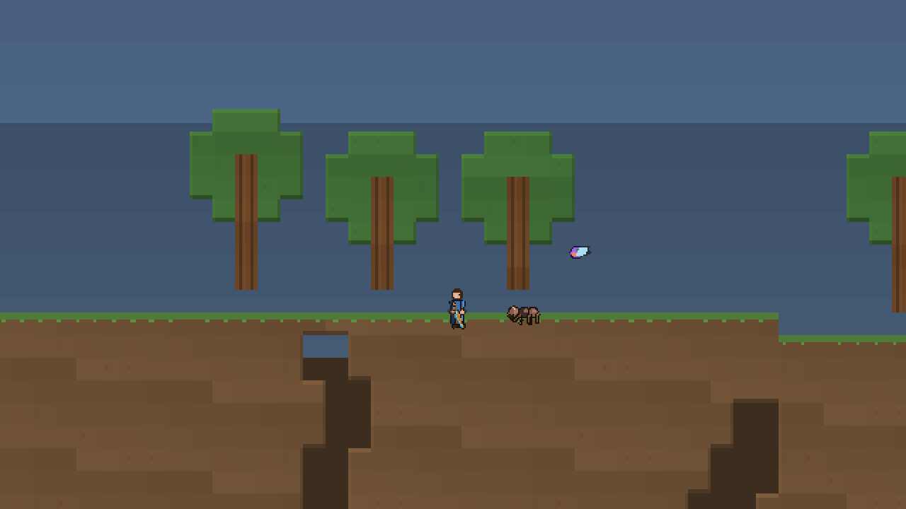

# 《裂界》M1 垂直切片

> 一句话：**挖下去，把矿变成武器，砍穿洞里的东西，然后被石喉教一遍怎么做动作游戏。**



## 现在能玩什么

```bash
love . rift          # 有存档自动接着玩，没有就开新局
```

| 操作 | 说明 |
|---|---|
| `A` / `D` 或 `←` / `→` | 移动 |
| `空格` | 跳跃（按住跳更高，点一下跳得矮） |
| 鼠标左键 | 指着方块＝挖掘；指着空气＝朝面向方向挥砍 |
| 鼠标右键 | 放置方块（消耗背包里的方块） |
| `C` | 打开合成台 |
| `R` | 重开（会覆盖存档） |

一条完整的流程：地表出生 → 顺着竖井往下挖 → 铜、铁、晶簇 → 合成铁剑 / 铁斧 / 晶刃
→ 一路清怪 → 挖到竖井底部的**脉动矿核** → 石喉从地下钻出来 → 三个阶段 → 打死。

## 已经做进去的

### 世界

- 200×120 tile 的确定性洞穴地图（种子 20261108）。同种子必然同地图，所以存档只存种子 + 改动过的方块。
- 分层：草皮 / 泥土 / 岩石 / 深岩，四层颜色递减，越深越暗。
- 洞穴由「团块噪声 + 等值线隧道」两套叠加，越深空腔越大。
- 铜 / 铁 / 晶簇按深度分带撒簇。另外沿竖井手放了 5 处「保底露头矿」，保证第一次下矿一定有东西可挖。
- 主竖井带之字形台阶，玩家能走下去而不是摔下去。
- 树有间距限制，否则相邻几棵会连成栅栏。

### 挖掘与建造

- 三层网格：前景（碰撞 + 可挖）、背景（洞壁，只渲染）、空气。挖掉一块，背景还在，所以洞是「洞」不是天空。
- 挖掘时间 = 硬度 / 工具效率，进度条按从下往上填充显示，松手会回退（回退比累积慢）。
- 镐等级不够挖不动：岩石要 1 级，深岩和晶簇要 2 级。
- 放置需要至少一边挨着已有方块，不能在半空乱放，也不能放进自己身体里。

### 战斗

- 帧数据三段式：前摇 / 判定 / 后摇。判定窗口比动画长一点——玩家看着差一点也能打中，手感立刻好一档。
- 剑 `0.085 + 0.070 + 0.200`，斧 `0.165 + 0.085 + 0.270`。斧慢、伤害高、破韧 30，专治石傀儡。
- 每次挥砍对每个敌人只结算一次（`hitSet`），否则一刀等于三刀，所有数值平衡失效。
- 打击反馈三层：hitstop（时间压到 6%，40~80ms）、相机震动、粒子。缺一层手感就发飘。
- 破韧：韧性打空进入硬直。剑砍石傀儡几乎打不出硬直，斧可以——这是「换武器」第一次有了非数值理由。

### 四种怪

| 怪 | 威胁 | 逼你做什么 |
|---|---|---|
| 矿虫 | 直线冲撞 | 跳过去或侧闪 |
| 洞穴蝠 | 空中骚扰、正弦摆动 | 抬头、抓时机 |
| 腐化爬行者 | 远程毒液 | 不要站着不动 |
| 石傀儡 | 慢、硬、19 伤害 | 破韧或绕后 |

精英词缀「爆裂」：血量翻倍，死亡时炸一圈。逼玩家在砍死它的瞬间后撤。

### 石喉（Boss）

900 血，三阶段，按 M1 的实际 DPS 标定（初始剑约 36 DPS → 25 秒纯输出，算上躲闪 45~60 秒一场）。

| 阶段 | 血量 | 教什么 |
|---|---|---|
| 1 | 100~70% | 看地面裂纹预判钻出位置 |
| 2 | 70~35% | 钻出时放两只矿虫，边躲边清 |
| 3 | 35~0% | 只剩尾节是弱点（2.2 倍伤害）；每 6 秒蓄力全屏 AOE，3 秒内打够 55 伤害才能打断 |

Boss 大部分时间在地下，只露出裂纹——既省美术，也逼玩家盯地面，这个动作本身就是教学。

### 合成

5 条配方，覆盖「挖到的东西能变成战斗力」这一条主线：

| 配方 | 材料 | 效果 |
|---|---|---|
| 铜剑 | 铜×3 木×2 | 13 → 16 |
| 铁剑 | 铁×3 木×1 | → 18 |
| 铁斧 | 铁×4 木×2 | 慢、破韧 30 |
| 晶刃 | 晶×3 铁×2 | → 24 |
| 洞穴口粮 | 几丁质×2 膜×1 | 回 40 血 |

换武器时镐也跟着升级——否则玩家打到铁却挖不动晶簇，会被迫在武器和工具之间二选一。

### 存档

- 只存：种子、玩家改动过的方块、背包、位置、血量、武器 spec、Boss 状态。
- 序列化成 Lua 字面量，400~800 字节。
- 坏存档、空存档、版本不匹配都会被安全忽略，不会崩。

## 刻意没做的

这些不是忘了，是判断「现在做会浪费」：

| 项 | 为什么先不做 |
|---|---|
| 1280×720 逻辑分辨率的整数缩放 | 先用窗口尺寸直接当视口，看得多比像素完美重要 |
| 专门 Boss 竞技场 | M1 只要验证「Boss 三阶段能打」，场地是 M2 的事 |
| 120 条配方 / 8 类武器 / 词条池 | 一条主线跑通再扩，否则数值全是猜的 |
| 音效 | 没有音频资产，硬塞合成音会更差 |
| 昼夜、天气、腐蚀扩散 | 都是「世界活着」的表现层，等核心循环稳了再加 |
| 手绘替换 | 设计文档里写了：等玩法定型再花钱，否则动作一改钱就白花 |

## 验证方式

这台开发机没有 OpenGL，`love` 起不来。所以：

- **逻辑**：`luajit tests/full.lua` → 488 条断言，其中 101 条是这一版新增的游戏核心断言。
- **画面**：`luajit tools/gameshot.lua out.bmp <场景>` 用纯 Lua 软光栅把 `Game:draw` 渲染成 BMP。同一份绘制代码在真机和软光栅上都能跑——这不是两套渲染，是一套。
- **视觉回归**：截图可以进 CI，同一份输入脚本出来的图应当逐像素稳定。

`tests/game.lua` 里几条值得单独说：

- 同种子必须生成同一张地图（否则存档只存种子不成立）
- 跳跃高度在 3~5 格之间（改重力后这条会立刻报警）
- 一次挥砍不会对同一只怪结算两次（这条坏了整个平衡就废了）
- Boss 会走完 `burrow → telegraph → emerge → charge` 整个循环（漏了计时器递减时，就是这条抓出来的）
- 存档往返后世界哈希一致
- 连续跑 30 秒乱按不会崩、坐标不是 NaN、不会掉出世界底部

## 已知问题

- 矿石斑点仍然偏「花纹」，尤其铁矿成片时像雪。等瓦片贴图替换时一起解决。
- Boss 头部细节不足，远看是一团橙色。钳子和三只眼在 `game/art/boss.lua` 里有，但 1.7 倍缩放下糊在一起。
- 洞穴背景层是纯色，没有纹理，大空腔里显得空。
- 战斗中挖掘需要长按 0.3 秒，但这条规则只在「260px 内有活怪」时生效，跑远一点就立刻能挖。
